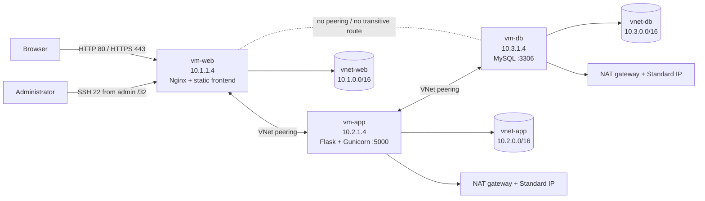

# Architecture

The browser loads the static page from Nginx. Nginx proxies same-origin `/api/` requests to Flask on `10.2.1.4:5000`; Flask connects to MySQL at `10.3.1.4:3306`. The API implements create, read, update, and delete operations for university assignments.

## Addressing

| Tier | VNet | VNet range | Subnet | Subnet range | VM/private IP | Public VM IP |
|---|---|---:|---|---:|---|---|
| Web | `vnet-web` | `10.1.0.0/16` | `subnet-web` | `10.1.1.0/24` | `vm-web` / `10.1.1.4` | One Standard static IP; DNS label `miniprojet-${students}` |
| App | `vnet-app` | `10.2.0.0/16` | `subnet-app` | `10.2.1.0/24` | `vm-app` / `10.2.1.4` | None; NAT gateway provides outbound-only SNAT |
| Database | `vnet-db` | `10.3.0.0/16` | `subnet-db` | `10.3.1.0/24` | `vm-db` / `10.3.1.4` | None; NAT gateway provides outbound-only SNAT |

All VMs use Ubuntu Server 22.04 LTS Gen2 (`22_04-lts-gen2`), `azureuser`, and public-key SSH authentication only. The app and database use their own Standard NAT gateway and static Standard public IP. NAT gateways are subnet-scoped and do not permit unsolicited inbound connections.

## NSG inbound policy

Each NSG is associated with its tier subnet. The explicit deny rule takes precedence over Azure's default inbound VNet allow rule.

| NSG | Priority | Action | Protocol/port | Source |
|---|---:|---|---|---|
| `nsg-web` | 100 | Allow | TCP 80, 443 | Internet |
| `nsg-web` | 110 | Allow | TCP 22 | `admin_ip_cidr` (/32) |
| `nsg-web` | 4096 | Deny | Any | Any |
| `nsg-app` | 100 | Allow | TCP 5000 | `10.1.1.0/24` |
| `nsg-app` | 110 | Allow | TCP 22 | `10.1.1.0/24` |
| `nsg-app` | 4096 | Deny | Any | Any |
| `nsg-db` | 100 | Allow | TCP 3306 | `10.2.1.0/24` |
| `nsg-db` | 110 | Allow | TCP 22 | `10.2.1.0/24` |
| `nsg-db` | 4096 | Deny | Any | Any |

The DB grants `appuser` only `SELECT`, `INSERT`, `UPDATE`, and `DELETE` on `university_assignments.*`, for the host pattern `10.2.1.%`.

## Peering and management path

There are four one-way peering resources: web→app, app→web, app→db, and db→app. Azure VNet peering is not transitive: a route from web to app and another from app to DB do not create a web-to-DB route. Consequently, `vm-web` can access the API but cannot connect to MySQL.

SSH follows the same boundaries. Connect to web from the administrator's `/32`, reach app through web, and reach DB through both web and app using the two-hop `ProxyJump` command in the Terraform output. A direct web-to-DB jump is intentionally not possible.
